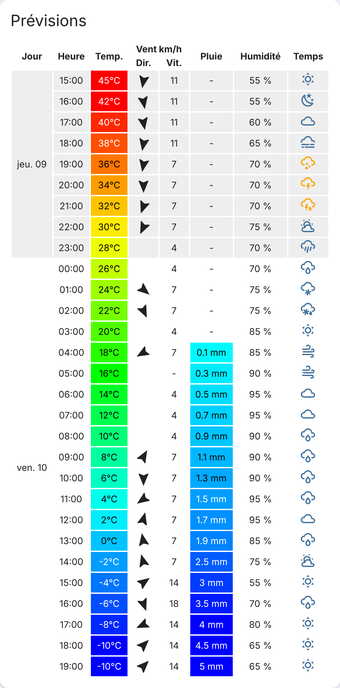

# Weather forecast table

Cette carte affiche les prévisions météo dans un **tableau** lisible d'un coup d'œil : une ligne par créneau, regroupées par jour.

## Aperçu

<picture>
  <source media="(prefers-color-scheme: dark)" srcset="docs/preview-dark.png">
  
</picture>

*Aperçu généré avec les données d'exemple de `index.js` (valeurs fictives).*

## Fonctionnalités

- Température colorée du bleu (froid) au rouge (chaud)
- Précipitations colorées selon l'intensité
- Direction et vitesse du vent (flèche orientée)
- Humidité et icône de la condition météo
- Jours alternés en lignes claires et foncées

## Prérequis

- Home Assistant **2024.3** ou plus récent
- Une entité `weather` qui fournit des prévisions (Météo-France, Met.no, OpenWeatherMap, etc.)

## Installation

### Avec HACS (recommandé)

1. Dans HACS, ouvrez le menu en haut à droite puis **Dépôts personnalisés**.
2. Ajoutez `https://github.com/devhablo/ha-weather-forecast-table` avec la catégorie **Dashboard**.
3. Recherchez **weather forecast table card**, installez-la, puis rechargez le navigateur.

### Manuellement

1. Téléchargez `weather-forecast-table.js` depuis la [dernière release](https://github.com/devhablo/ha-weather-forecast-table/releases/latest).
2. Copiez-le dans le dossier `config/www/` de Home Assistant.
3. Ajoutez la ressource dans **Paramètres → Tableaux de bord → ⋮ → Ressources** :
   - URL : `/local/weather-forecast-table.js`
   - Type : **Module JavaScript**

## Configuration

```yaml
type: custom:weather-forecast-table
entity: weather.maison
name: Prévisions
forecast_type: hourly
```

| Option          | Type   | Obligatoire | Défaut   | Description                                                   |
| --------------- | ------ | ----------- | -------- | ------------------------------------------------------------- |
| `type`          | texte  | oui         |          | `custom:weather-forecast-table`                               |
| `entity`        | texte  | oui         |          | Identifiant de l'entité météo (par exemple `weather.maison`)  |
| `name`          | texte  | non         | (aucun)  | Titre affiché en haut de la carte                             |
| `forecast_type` | texte  | non         | `hourly` | Type de prévision : `hourly`, `daily` ou `twice_daily`        |

